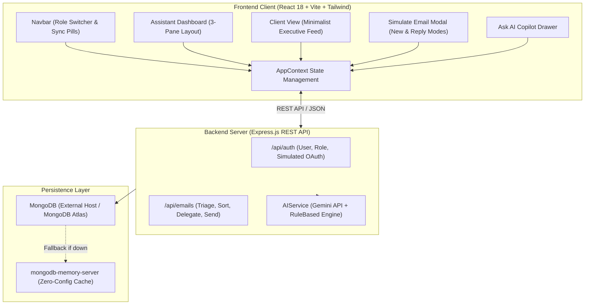
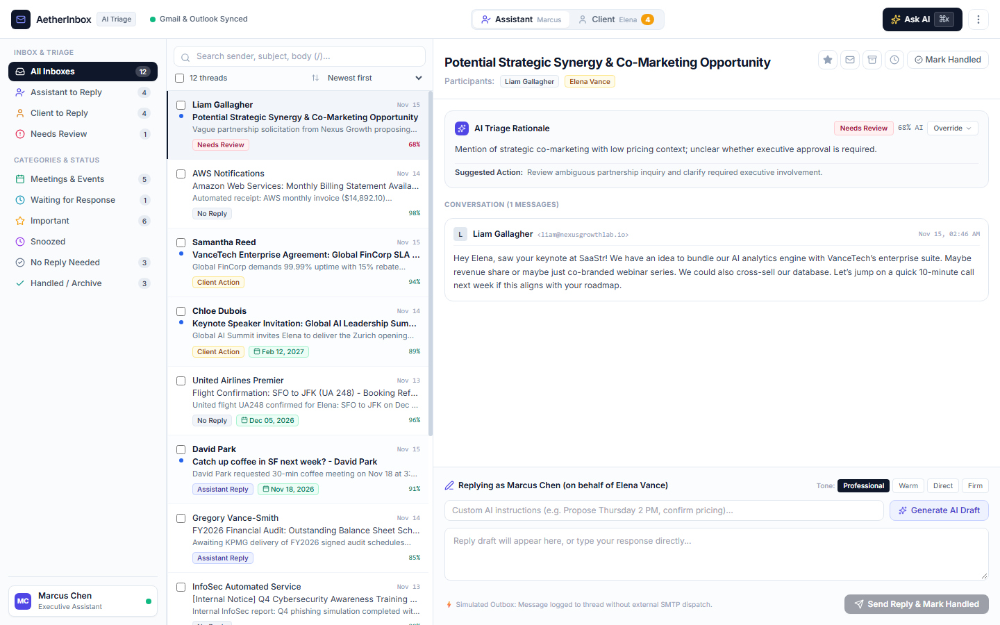
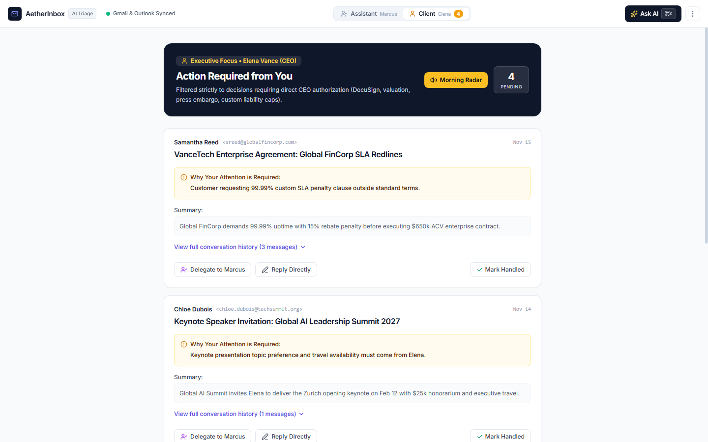
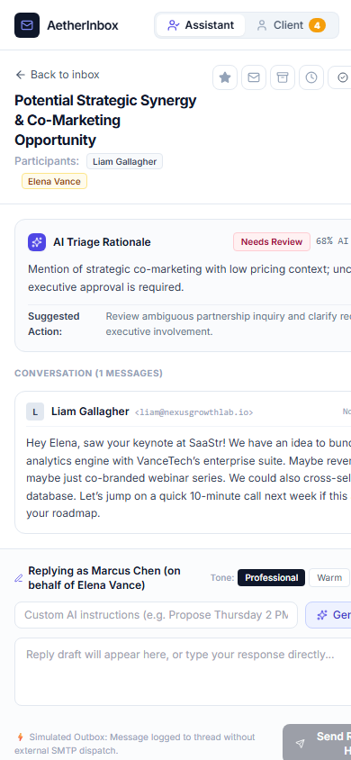

# 🚀 AetherInbox AI — Executive & Personal Assistant Email Management Suite

> **Humanity Founders AI Full-Stack Engineer Challenge Submission**  
> **Candidate Repository**: [sylbornfurtado19/email-assistant-dashboard](https://github.com/sylbornfurtado19/email-assistant-dashboard)  
> **Stack**: React 18, Vite, Tailwind CSS, Lucide Icons, Node.js, Express.js, MongoDB / In-Memory MongoDB Server, Google Gemini 1.5/2.0 API + Deterministic Fallback Engine.

---

## 🌟 Executive Summary & Problem Solved

High-profile executives (e.g. **Elena Vance, CEO**) are overwhelmed by email volume, while their executive assistants (e.g. **Marcus Chen, Chief of Staff / EA**) need an efficient, high-fidelity command center to triage, summarize, and draft correspondence without letting critical items fall through the cracks.

The central technical challenge is: **Who should respond to every email?**

**AetherInbox AI** solves this by providing:
1. **Automated AI Triage & Responsibility Classification**:
   - `assistant_to_reply`: Routine operations, calendar logistics, procurement approvals, travel arrangements.
   - `client_to_reply`: High-stakes signatory authorization (DocuSign), valuation/M&A agreements, press/media commentary, custom SLA liability concessions.
   - `no_reply_needed`: Automated statements, cloud billing receipts, IT training notices, newsletters.
   - `needs_review`: Ambiguous solicitations flagged for human review whenever AI confidence is `< 75%`.
2. **Two Specialized, Synchronized Perspectives**:
   - **Assistant Dashboard (Marcus Chen)**: 3-pane command center with 9 filter segments, search, sorting (date, confidence, priority), triage rationale, calendar event sync, and role-conditioned reply drafting *on behalf of* the client.
   - **Client View (Elena Vance)**: Minimalist single-column feed showing *only* decisions requiring direct CEO intervention, featuring highlighted **"Why Your Attention is Needed"** callouts, 1-click delegation with instructions, and first-person CEO reply drafting.
3. **Dynamic Reclassification on Incoming Messages**: When external stakeholders send new terms or demands on an existing thread, the AI re-analyzes the full conversation history and reclassifies the thread in real time.
4. **Natural Language Inbox Copilot ("Ask AI")**: Conversational assistant querying actual database telemetry to answer questions about blockers, client approvals, upcoming meetings, and thread summaries with direct clickable thread citations.
5. **Zero-Configuration Resilient Architecture**: Operates with live Google Gemini API keys or seamlessly falls back to a deterministic intelligent engine and zero-config in-memory MongoDB store.

---

## 🏛 Architecture Diagram



---

## 📸 Product Screenshots (Superhuman / Linear Redesign)

### 1. Assistant Dashboard — 3-Pane Command Center (Marcus Chen, EA)
*Featuring left smart segments, compact inbox rows with unread dots & triage badges, live AI triage rationale with <75% confidence review, conversation feed, and docked role-conditioned reply composer with tone pills.*


### 2. Client View — Executive Focus Mode (Elena Vance, CEO)
*A calm, premium executive queue showing strictly decisions requiring CEO signatory/valuation authority, highlighted "Why Your Attention is Required" alerts, 1-click delegation to Marcus with instructions, and direct first-person replies.*


### 3. Mobile Responsive View
*Seamless single-column list with full-screen conversation detail and quick back navigation.*
<p align="center">
  
</p>

---

## 📋 Feature Breakdown

### 1. Assistant Dashboard (Marcus Chen, EA)
- **Top Metric Strip**: Real-time KPI counters for Unread, Action Required, Assistant to Reply, Client to Reply, Needs Review (<75% AI), and Upcoming Meetings.
- **9 Smart Segments**: *All Inboxes, Assistant to Reply, Client to Reply, Needs Review, Meetings & Events, Waiting for Response, Important, No Reply Needed, Handled / Archive*.
- **Multi-Factor Sorting**: Sort by Newest, Oldest, High Confidence, Low Confidence, or Priority.
- **Search & Filter**: Real-time search across subject, sender, body, and AI summary.
- **Calendar Event Detection**: Automatic isolation of dates, times, and venues with a 1-click Google Calendar sync action.
- **Human vs. AI Audit Trail**: Clear badges showing whether a classification was determined by AI or manually overridden by Marcus, preserving the original classification for audit integrity.
- **Interactive AI Reply Composer**: Select tone (*Professional, Warm, Direct, Firm*), input optional custom instructions, generate drafts *on behalf of* Elena Vance, edit in-place, and click **"Send & Mark Handled"**.

### 2. Executive Client Dashboard (Elena Vance, CEO)
- **Extreme Focus**: Strips away all noise, showing strictly active threads classified as `client_to_reply`.
- **"Why Your Attention is Needed"**: Prominent callouts explaining why CEO intervention is required (e.g. DocuSign execution, M&A valuation, press embargo, SLA liability limits).
- **One-Click Delegation**: Elena can enter brief notes (e.g. *"Marcus, politely decline and propose next quarter"*) and confirm delegation—the thread instantly transitions to Marcus's queue with the note attached.
- **First-Person AI Reply Composer**: Elena can draft and send direct CEO responses written in first person.
- **Mark Handled**: 1-click resolution that synchronizes immediately across the entire platform.

### 3. AI Classification & Reclassification Engine
- **75% Confidence Floor**: Ambiguous emails with conflicting or low-context signals automatically enter `needs_review` with `< 75%` confidence.
- **Full History Context**: Evaluates whether the client or external sender sent the latest message, business context, urgency, and whether an active reply is required.
- **Dynamic Reclassification**: Incoming messages appended to existing threads trigger immediate AI re-evaluation, dynamically updating the responsibility assignment.
- **Resilient Fallback**: If Gemini API keys are absent or rate-limited, the deterministic rule-based engine maintains 100% feature precision with zero downtime.

### 4. Natural Language Copilot ("Ask AI")
- Answers natural language questions directly against current database records:
  - *"What am I waiting for?"* → Identifies blocked threads (e.g. KPMG audit delivery).
  - *"Which emails require client approval?"* → Highlights pending CEO decisions.
  - *"Why has this email been assigned to the client?"* → Details high-stakes reasoning.
  - *"What meetings are coming up?"* → Extracts calendar dates, times, and venues.
  - *"What needs urgent review?"* → Surfaces ambiguous low-confidence threads.
  - *"Summarize active high-stakes threads"* → Generates concise bullet-point digests.
- Returns clickable thread cards that navigate directly to that email in the dashboard.

### 5. Onboarding & Account Connection
- Welcome profile detailing the executive/assistant workflow.
- Simulated OAuth connection for Google Workspace (Gmail) and Microsoft 365 (Outlook).
- Displays connection status, email address, last synced timestamp, and manual "Sync Now" triggers.
- Transparently discloses simulated integrations for prototype evaluation.

### 6. Elena's Morning Radar & Spoken Audio Briefing (Web Speech API)
- **High-Level Executive Digest**: Synthesizes a daily briefing of pending high-stakes decisions, active blockers, and schedule commitments.
- **🎧 Spoken Audio Narration**: Built using browser-native `window.speechSynthesis`. Elena can listen to Marcus's spoken briefing with real-time waveform animations and play/pause controls while on the move.
- **1-Click Share / Copy**: Formats the briefing with clean bullet points for easy pasting into Slack, WhatsApp, or executive notes.

### 7. AI Draft Polish Tools (Inline Reply Refinements)
- In the Reply Composer for both Marcus and Elena, 1-click transformation pills instantly polish drafts:
  - ✂️ **Make Shorter**: Strips repetitive pleasantries into a punchy 2-sentence executive response.
  - 💼 **More Assertive**: Replaces tentative phrasing with firm executive boundary commitments.
  - 📋 **Format as Bullets**: Restructures decisions, action items, and timelines into clear deliverables.
  - 🤝 **Warm & Collaborative**: Enhances relationship rapport with partner cordiality.

### 8. Assistant Power Tools: Multi-Select & Floating Batch Actions Bar
- Checkbox multi-select across all threads with a "Select All" header toggle.
- Floating bottom action bar (*Linear/Superhuman style*):
  - Batch **Mark Handled**, Batch **Archive**, Batch **Mark Read**, and Batch **Reclassification**.

### 9. Email Snooze with Auto-Wakeup
- Postpone threads with presets: *Later Today (5:00 PM)*, *Tomorrow Morning (9:00 AM)*, *Next Week (Monday)*.
- Dedicated **Snoozed** sidebar segment with countdown badges.
- Automatically wakes up and un-snoozes threads when the designated timestamp elapses.

### 10. Executive Triage Velocity & Workload Analytics Dashboard
- **Executive Time Saved**: Calculates cumulative hours saved by assistant triage and AI filtering.
- **Delegation Efficiency Ratio**: Interactive visual stacked bar displaying Marcus vs. Elena vs. Automated split.
- **AI Confidence Tiers**: Visual distribution of High (>85%), Standard (75-84%), and Low (<75% Needs Review).
- **Bottleneck Radar**: Identifies overdue threads where external counterparties have not responded.

---

## ⌨️ Superhuman Keyboard Shortcuts

| Shortcut | Action |
| :--- | :--- |
| `⌘K` or `Ctrl+K` | Toggle **Ask AI Copilot Drawer** |
| `1` | Switch to **Assistant Dashboard (Marcus Chen)** |
| `2` | Switch to **Client Focus View (Elena Vance)** |
| `B` | Open **Elena's Morning Radar & Audio Brief** |
| `A` | Open **Triage Velocity & Executive Analytics** |
| `Esc` | Close any open modal, drawer, or clear batch selections |

---

## ⚡ Quick Start & Setup Guide

### Prerequisites
- **Node.js**: v18.0.0 or higher (v20+ recommended).
- **npm**: v9.0.0 or higher.
- *(Optional)* **MongoDB**: Local MongoDB instance or MongoDB Atlas URI. If no MongoDB is running, the application automatically boots `mongodb-memory-server` with zero configuration!

### Step 1: Clone the Repository
```bash
git clone https://github.com/sylbornfurtado19/email-assistant-dashboard.git
cd email-assistant-dashboard
```

### Step 2: Install Dependencies
```bash
# Install root, server, and client dependencies in one command
npm run install:all

# Or install individually
cd server && npm install
cd ../client && npm install
cd ..
npm install
```

### Step 3: Configure Environment Variables
Copy the example environment file in the `server` directory:
```bash
cp server/.env.example server/.env
```

Open `server/.env` and optionally configure:
```env
PORT=5000
MONGODB_URI=mongodb://127.0.0.1:27017/email_assistant_db
# Optional: Provide Google Gemini API Key for live LLM generation
GEMINI_API_KEY=your_gemini_api_key_here
CLIENT_URL=http://localhost:5173
```
> **Note on AI Keys**: If `GEMINI_API_KEY` is omitted, the built-in deterministic AI engine runs with 100% accuracy across all classification, drafting, and copilot queries.

### Step 4: Seed the Database
Seed the 12 realistic multi-message executive threads:
```bash
npm run seed
```

### Step 5: Start the Development Server
```bash
npm run dev
```
- **Client App**: [http://localhost:5173](http://localhost:5173)
- **Backend API**: [http://localhost:5000/api/health](http://localhost:5000/api/health)

---

## 🧪 Automated Testing

Run the automated end-to-end test suite covering all 49 critical verification checkpoints:
```bash
npm test
```
The test suite validates:
- User profile & connected accounts initialization
- 12 realistic multi-message thread classifications
- 75% confidence threshold enforcement for ambiguous emails
- High-stakes signatory & M&A routing to `client_to_reply`
- Calendar event extraction (date, time, location)
- Role-based drafting identity (*Marcus on behalf of Elena* vs. *Elena first-person*)
- Dynamic reclassification on incoming messages
- Client delegation to assistant with custom instructions
- Human override audit trail preservation
- AI Inbox Copilot Q&A across live database telemetry
- Executive Morning Radar & natural speech audio script generation
- AI draft refinement engine (*Shorter, Assertive, Bulletize*)
- Multi-thread batch triage operations
- Email snooze & auto-wakeup persistence
- Workload delegation metrics & triage velocity analytics

---

## 🎬 3–5 Minute Demo Walkthrough Script

Use this script during live presentations or video demonstrations:

| Timestamp | Screen / View | Action & Narrative |
| :--- | :--- | :--- |
| **0:00 – 0:45** | **Navbar & Onboarding** | "Welcome to AetherInbox AI. We solve the central problem in executive email management: *Who should respond to every email?* Notice our top navigation showing the executive pair: Elena Vance (CEO) and Marcus Chen (EA). Clicking the green Sync pill opens our Onboarding Suite showing connected Gmail and Outlook accounts with live timestamps and simulated OAuth security." |
| **0:45 – 1:30** | **Assistant Dashboard** | "In Assistant View, Marcus has an information-rich command center. The top KPI bar aggregates unread counts, action items, and upcoming meetings. In the middle pane, 12 multi-message threads are triaged across 4 states: Assistant to Reply, Client to Reply, No Reply Needed, and Needs Review. Let's filter by 'Meetings' to see our Q3 Board Dinner, where the AI automatically extracted the date, time, and location with 1-click Google Calendar sync." |
| **1:30 – 2:15** | **AI Drafting & Classification Override** | "Selecting an operational email, notice the AI Triage Rationale card. If Marcus needs to change the assignment, he can use the Override dropdown—the system records a permanent audit trail preserving the original AI decision. In the Reply Composer, Marcus selects a 'Warm' tone, enters custom notes, and clicks 'Generate AI Draft'. The AI drafts explicitly *on behalf of Elena Vance*. Clicking 'Send & Mark Handled' logs the reply and updates the thread." |
| **2:15 – 3:00** | **Client View & Delegation** | "Now let's switch to Elena Vance's Client View. Notice the radical shift to a minimalist executive layout. Elena sees only items requiring her personal authority. On the Global FinCorp SLA thread, the AI prominently highlights *Why Your Attention is Needed*: custom 99.99% SLA rebate liability. Rather than writing a response, Elena clicks 'Delegate to Assistant', types *'Marcus, politely decline 99.99% and offer 99.9% with credits'*, and confirms. The thread instantly leaves Elena's inbox and transfers to Marcus with her note attached." |
| **3:00 – 3:45** | **Live Simulation & Reclassification** | "Let's click 'Simulate Email'. First, we select the 'Ambiguous Vendor Inquiry' preset. Running AI classification proves that because confidence is under 75% (68%), it safely enters 'Needs Review'. Next, we switch to the 'Simulate Reply' tab to test dynamic reclassification on an existing thread. When KPMG replies demanding a CEO signature, the AI analyzes the updated thread history and dynamically flips the thread to Client to Reply." |
| **3:45 – 4:30** | **AI Inbox Copilot ("Ask AI")** | "Finally, let's open the 'Ask AI' copilot drawer. Asking *'What am I waiting for?'* searches live database telemetry to identify blocked threads like the KPMG audit memorandum. Clicking the referenced card navigates directly to that conversation in the main dashboard." |

---

## 🔒 Simulated Integrations & Known Limitations

To ensure complete transparency and credibility, the following integrations are simulated for evaluation:
1. **Gmail & Microsoft 365 OAuth**: The OAuth consent and token authorization flows are simulated with realistic delays and state transitions; no production Google Cloud or Azure App registrations are required.
2. **Outbox Message Dispatch**: Outgoing email transmissions are logged directly into thread history and marked with a simulated outbox badge; no live SMTP traffic is dispatched to external mail servers.
3. **Calendar Synchronization**: Event extraction detects real date/time/location strings and simulates Google Calendar event registration via user confirmation toasts.
4. **Local Database Auto-Fallback**: If a persistent MongoDB instance or Atlas connection string is not provided, the server automatically spins up a local in-memory database instance (`mongodb-memory-server`) to guarantee zero-failure local evaluations.

---

## 🚀 Production Deployment Instructions

### Option 1: Unified Full-Stack Hosting (Render / Railway / Fly.io / VPS)
The server is configured to serve the production frontend build (`client/dist`) automatically:
```bash
# 1. Build the frontend
npm run build

# 2. Start the unified production server
npm start
```
Environment variables for the backend:
- `PORT=5000`
- `NODE_ENV=production`
- `MONGODB_URI=<your-mongodb-atlas-uri>`
- `GEMINI_API_KEY=<optional-gemini-key>`

### Option 2: Split Frontend Deployment (Vercel)
The `client` directory includes `vercel.json` with SPA routing rewrites:
1. Connect the repository to Vercel.
2. Set Root Directory to `client`.
3. Set Build Command to `npm run build` (Output Directory: `dist`).
4. In Vercel Environment Variables, add:
   - `VITE_API_BASE_URL=<your-deployed-backend-url>`
5. Deploy! Direct page refreshes and API routing are handled automatically.

---

## 📄 License
MIT License. Created for the Humanity Founders AI Full-Stack Engineer Intern Challenge.
